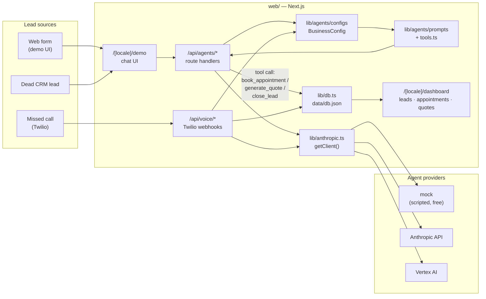
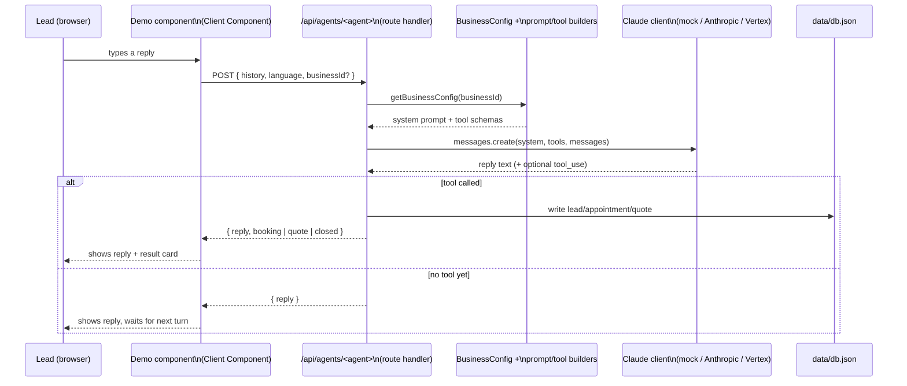
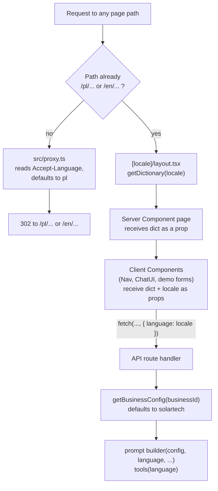

# Architecture

Diagrams of the whole pipeline, from a lead's first contact to a dashboard
update. Renders natively on GitHub and in VS Code's Markdown preview
(Mermaid). For the code layout these diagrams map to, see
[code-structure.md](code-structure.md); for the agent config system, see
[agent-templates.md](agent-templates.md).

## 1. End-to-end pipeline

## 2. One chat turn (sequence)

## 3. Locale & config resolution

